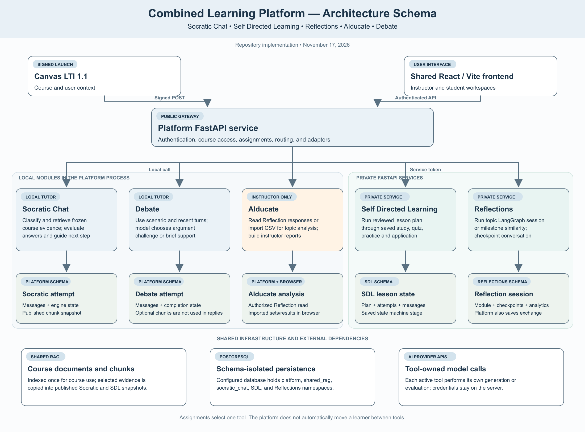
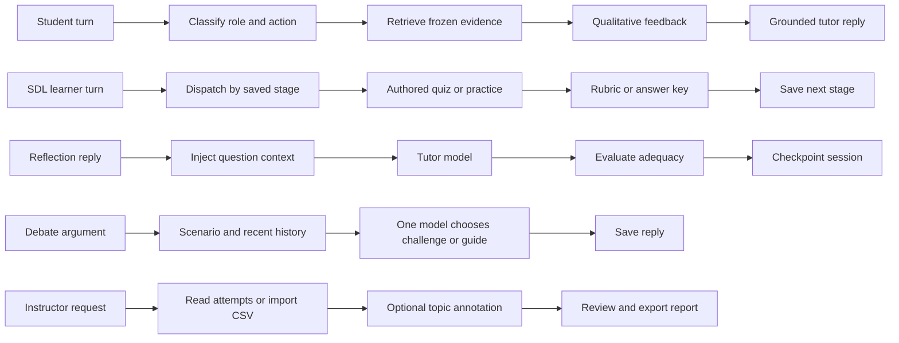
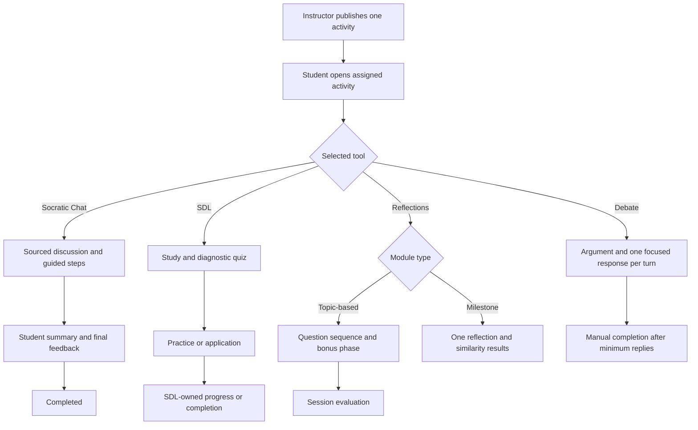
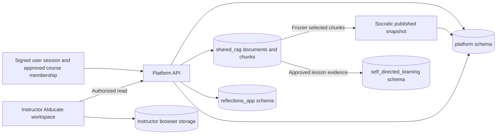

# Combined Learning Platform Architecture

**Socratic Chat · Self Directed Learning · Reflections · AIducate · Debate**
Originally prepared November 9, 2026, from preview commit `8b56730`. Revised November 17, 2026, against the current repository working tree.

## Purpose and scope

This document describes the integrated learning platform, its module boundaries, its request and learning flows, and the storage location of student and instructor state. It reflects repository behavior rather than the health or configuration of a particular deployment. The five figures provide complementary views of the same system: service topology, software and AI modules, student activity flows, launch and request routing, and data boundaries.

The platform exposes a shared React/Vite frontend and a FastAPI gateway. It reuses the Socratic application's identity and course APIs. Socratic Chat and Debate execute within the platform process; Self Directed Learning (SDL) and Reflections execute in separate FastAPI services. AIducate is an instructor analysis workspace in the platform frontend and API. It analyzes Reflection responses, but it is not a publishable student activity. Each published student assignment selects one learning tool. The tools do not automatically transfer a learner or attempt between activities.

## Implementation inventory

| Capability | Runtime owner | Main workflow | Persisted state |
| --- | --- | --- | --- |
| Shared platform | Platform FastAPI process | Identity, Canvas launch, course authorization, assignment publication, routing and common attempts | `platform` schema |
| Socratic Chat | Local platform modules using the Socratic backend package | Classify, retrieve frozen course evidence, evaluate eligible answers, generate grounded turns and final feedback | Published snapshot, messages and engine state in the platform attempt |
| Self Directed Learning | Separate SDL FastAPI service | Prepared lesson plan and persisted lesson state machine | SDL-owned assignments, lesson snapshots, attempts and messages in `self_directed_learning` |
| Reflections | Separate Reflections FastAPI service | Topic-based LangGraph session or milestone similarity route | Module data, conversation analytics and LangGraph checkpoints in `reflections_app`; platform attempt also records the assignment exchange |
| AIducate | Platform instructor frontend and analysis API | Read Reflection attempts or import a CSV, inspect participation, optionally classify imported responses, produce an instructor report | Source assignments remain in the platform; imported sets and saved analysis results are held in the instructor's browser storage; API analysis is request scoped |
| Debate | Local platform module | Scenario-based argument challenge or support, selected within one model call | Published configuration, messages and completion status in the platform attempt |

## Figure 1. Combined system architecture

Canvas can launch the platform through a signed LTI 1.1 request. The platform then resolves the user and course, checks approved membership, and serves the integrated frontend. Browser requests reach the platform API. The platform invokes Socratic and Debate locally and calls SDL or Reflections through token-protected service endpoints. All three FastAPI processes can use the same PostgreSQL instance while retaining separate schema ownership. Model calls are made by the component that owns each activity's AI workflow.



[Editable SVG](combined-learning-platform-schema.svg)

**Interpretation.** The diagram shows ownership and calls, not automatic movement between tools. Shared course documents are indexed for retrieval, while published activities retain the material or lesson snapshot required by their own workflow. Reflections does not automatically retrieve selected shared documents during its topic chat.

## Figure 2. Combined modules and AI implementation

The tools use different control policies. Socratic Chat routes each turn through classification, evidence retrieval, qualitative evaluation when eligible, guided-step readiness when configured, and response generation. SDL uses explicit lesson stages; its published plan controls questions, answer keys, practice assets and rubrics. Reflections uses LangGraph nodes and PostgreSQL checkpoints for topic sessions, with a separate milestone similarity route. Debate instructs one response model to choose between Devil's Advocate and Student Guide modes. AIducate is instructor initiated analysis rather than a student tutor.



The detailed algorithm figures are available as editable SVGs: [Socratic Chat](socratic-questioning-agent-algorithm.svg), [SDL](sdl-agent-algorithm.svg), [Reflections](reflections-agent-algorithm.svg), [AIducate](aiducate-agent-algorithm.svg), and [Debate](debate-agent-algorithm.svg).

## Figure 3. Combined student learning flows

An instructor publishes a configured assignment for a course and its recipients. The student's activity route is determined by the assignment's selected tool. Socratic Chat opens with a prompt or guided scenario, develops the discussion from selected course evidence, and requires a learner-written summary and generated final feedback before submission. SDL opens a saved lesson and proceeds through its bounded or standard V2 state machine. Topic-based Reflections asks planned questions, records adequacy and weak areas, and evaluates the session at the end; milestone Reflections accepts a single response and performs a historical similarity lookup. Debate challenges or supports the student's argument until the configured minimum number of student replies permits manual completion. AIducate is accessed by instructors after student work exists.



The SDL bounded flow is enabled when starting and ending outcomes are configured. It requires prerequisite confirmation, study, five authored quiz questions, optional targeted review for missed first attempts, and a rubric-assessed application task. The standard V2 path instead uses a familiarity prompt, study resources, five diagnostic questions, learner-selected adaptive practice, and reflection. The SDL service saves its own stage after each turn.

## Figure 4. Combined launch and request sequence

The LTI 1.1 path verifies the signed Canvas launch and creates or resolves platform identity and course context. A direct platform login reaches the same authenticated assignment API. For each student request, the platform checks access and routes the turn to the selected owner. SDL and Reflections receive server-to-server requests with a platform service token; the browser does not receive that token. Local Socratic and Debate calls remain in the gateway process.

```mermaid
sequenceDiagram
    participant Canvas
    participant Browser as Student browser
    participant Platform as Platform API
    participant DB as PostgreSQL
    participant SDL as SDL service
    participant Ref as Reflections service
    Canvas->>Platform: Signed LTI 1.1 launch
    Platform->>Platform: Verify launch signature and timestamp
    Platform->>DB: Consume nonce; resolve identity, course, and membership
    Platform-->>Browser: Session and course-scoped frontend
    Browser->>Platform: Start or resume assignment
    Platform->>DB: Check assignment and recipient access
    alt Socratic Chat or Debate
        Platform->>Platform: Execute local activity engine
        Platform->>DB: Save platform attempt
    else Self Directed Learning
        Platform->>SDL: Forward authorized request with service token
        SDL->>DB: Load and save SDL lesson state
    else Reflections
        Platform->>Ref: Forward authorized request with service token
        Ref->>DB: Load and save module session or milestone result
        Platform->>DB: Save platform assignment exchange
    end
    Platform-->>Browser: Return current activity state
```

Instructor AIducate requests follow a separate path: the platform checks instructor access, returns saved Reflection responses or accepts an instructor-supplied CSV, and runs requested analysis. The report builder returns HTML to the browser for review and download.

## Figure 5. Data storage and access boundaries

The platform schema owns users, courses, memberships, assignment configuration, recipients and common attempts. Shared RAG tables hold course documents and indexed chunks. Publishing Socratic Chat freezes selected chunks into the assignment snapshot. SDL publication copies its approved plan and selected source evidence into the SDL service's lesson store; SDL owns subsequent learning state. Reflections owns modules, conversations, analytics and checkpoints in its schema, while the platform retains the assignment exchange used for common progress and instructor access. AIducate reads platform Reflection attempts but does not create a student assignment or a server-side analysis table.



| Boundary | Access and persistence rule |
| --- | --- |
| Platform assignment | A published configuration is immutable; the recipient and approved course membership checks govern access. |
| Shared documents | Course-scoped upload and retrieval enforce ownership and membership. The client receives text and metadata rather than embedding vectors. |
| Socratic assignment | The platform attempt stores chat and engine state; retrieval is limited to the assignment's frozen selected material. |
| SDL | The platform supplies authenticated identity and a service token; SDL persists its own lesson snapshot, attempts and stage transitions. |
| Reflections | The platform supplies authenticated identity and a service token; the Reflections service owns module execution and checkpoint data. |
| AIducate | Instructor-only APIs return authorized responses. Imported sets and saved analysis results are stored in browser local storage; model annotation requests are bounded and request scoped. |
| Debate | The platform owns the attempt and reply history. The active response path currently uses the scenario and recent turns. |

## Implementation qualifications

1. **AIducate is an analysis workspace.** It can inspect published Reflection assignments and instructor-imported reflection data. Its assignment type remains draft-only because no student activity engine is connected.
2. **Debate document retrieval is currently bypassed.** Publication can freeze optional document chunks, and a later branch in `platform_app/engines.py` contains retrieval logic. An earlier Debate return executes first, so active replies receive the scenario and recent conversation without those chunks. This document describes that executable path rather than the intended retrieval behavior in `docs/debate.md`.
3. **The five tools have distinct completion semantics.** Socratic Chat requires final feedback on a learner summary; the SDL service decides its own stage and completion; Reflections has topic and milestone routes; Debate applies a configurable minimum reply count; AIducate has no student completion state.
4. **These figures are implementation views.** They do not assert that provider keys, external services, Canvas registration or a particular deployment are currently available.

## Source basis

- **Shared platform:** `platform_app/main.py`, `platform_app/routes.py`, `platform_app/engines.py`, `platform_app/store.py`, `platform_app/workspace.py`, `platform_app/shared_rag.py`, `platform_app/reflection_analysis.py`, and `platform_app/migrations/`.
- **Frontend:** `platform_frontend/src/StudentWorkspace.jsx`, `platform_frontend/src/SDLWorkspace.jsx`, `platform_frontend/src/ReflectionAssignment.jsx`, and `platform_frontend/src/AiducateWorkspace.jsx`.
- **Socratic Chat:** `Socratic-Chat/backend/app/classifier.py`, `answer_evaluation.py`, `rag.py`, and `db.py`.
- **Self Directed Learning:** `adaptive-learning-app/backend/app/platform_lessons.py`, `lesson_flow.py`, `bounded_flow.py`, `targeted_practice.py`, and `db.py`.
- **Reflections:** `reflections-app/backend/app/agents/runner.py`, `agents/graphs/`, `agents/nodes/`, `routes/platform.py`, and `services/rec_sys_service.py`.
- **Debate:** `platform_app/debate.py` and the Debate branches of `platform_app/engines.py`.

This architecture review did not execute or modify application code. No live service, model quality, or deployment verification is implied.
